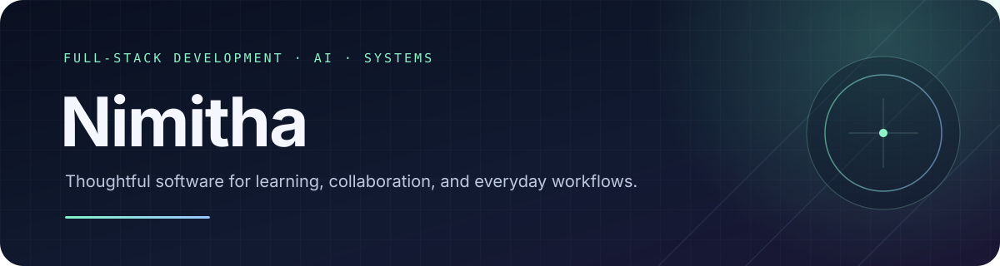

  

  <h1>Thoughtful products. Practical engineering.</h1>
  
<code>FULL-STACK DEVELOPER&nbsp; / &nbsp;AI&nbsp; / &nbsp;SYSTEMS</code>

  
I’m Nimitha — I build useful software from the first interface to the systems behind it.

  

    
    
  

---

## <code>01 / ABOUT</code>

I enjoy taking an idea all the way to a working product: shaping a clear interface, connecting the APIs and data behind it, and polishing the details. My projects span learning tools, campus platforms, AI-powered search, real-time workflows, and operating-system concepts.

## <code>02 / SELECTED WORK</code>

<table>
  <tr>
    <td width="50%" valign="top">
      <h3><a href="https://github.com/NIMITHASHREE/PRISM">01 · PRISM ↗</a></h3>
      
A placement-preparation platform with learning paths, resume tools, AI mock interviews, mentorship, and progress tracking.

      
<code>AI</code> <code>LEARNING</code> <code>CAREER TOOLS</code>

    </td>
    <td width="50%" valign="top">
      <h3><a href="https://github.com/NIMITHASHREE/TechTask_Event">02 · EventHub ↗</a></h3>
      
Campus event discovery and management, with student registration and organizer workflows.

      
<code>WEB APP</code> <code>EVENTS</code> <code>WORKFLOWS</code>

    </td>
  </tr>
  <tr>
    <td width="50%" valign="top">
      <h3><a href="https://github.com/NIMITHASHREE/EduKno">03 · EduKno ↗</a></h3>
      
An education portal featuring semantic search, a RAG assistant, recommendations, and gamified learning.

      
<code>RAG</code> <code>SEARCH</code> <code>RECOMMENDATIONS</code>

    </td>
    <td width="50%" valign="top">
      <h3><a href="https://github.com/NIMITHASHREE/EduLedger">04 · FST Records ↗</a></h3>
      
Faculty records, marks, attendance, and reporting, paired with a <a href="https://github.com/NIMITHASHREE/fst_client">React/Vite client</a>.

      
<code>EDTECH</code> <code>DATA</code> <code>REACT</code>

    </td>
  </tr>
  <tr>
    <td width="50%" valign="top">
      <h3><a href="https://github.com/NIMITHASHREE/MiniOSPro">05 · MiniOS Pro ↗</a></h3>
      
A C++17 simulator for CPU scheduling, memory, filesystems, deadlock detection, and synchronization.

      
<code>C++17</code> <code>OPERATING SYSTEMS</code>

    </td>
    <td width="50%" valign="top">
      <h3><a href="https://github.com/NIMITHASHREE/Industrial-Vist-Management-System">06 · Industrial Visit Manager ↗</a></h3>
      
A multi-role academic visit workflow for proposals, approvals, company coordination, and reporting.

      
<code>FULL-STACK</code> <code>PRODUCT WORKFLOWS</code>

    </td>
  </tr>
</table>

## <code>03 / TOOLKIT</code>

<code>FRONTEND</code>

  

<code>BACKEND / API</code>

  

<code>DATA / SYSTEMS</code>

  

Also working with FastAPI, Spring Boot, and Socket.IO.

## <code>04 / CURRENT CURIOSITIES</code>

<code>AI-powered search</code> · <code>RAG</code> · <code>recommendation systems</code> · <code>real-time collaboration</code> · <code>operating systems</code>

---

  
<strong>Want the full picture?</strong>

  
<a href="https://nimithashree-portfolio.vercel.app">Visit my portfolio ↗</a> &nbsp;·&nbsp; <a href="https://github.com/NIMITHASHREE?tab=repositories">Browse all repositories ↗</a>

  
Designed with care · Built in public

